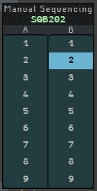
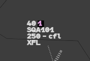
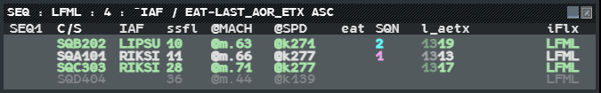
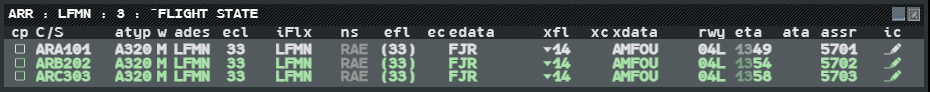

When you sequence several arrivals, you can give each flight a number by hand. Two lists
help you see the arrivals of an airport: the Sequencing List, sorted by exit time, and the
Arrival List.

## Give a sequence number

1. Left click the callsign to open the **Callsign Menu**.
2. Left click **Sequence...**. The **Manual Sequencing** menu opens: two columns, **A** and
   **B**, each with the numbers 1 to 9.
3. Left click the number you want in the sequence you want. The menu closes.

Move the pointer out of the menu to close it without choosing. When you reopen it, a
triangle marks the number the flight already has.

There are two sequences because an approach often runs two (one per runway, or one per
initial approach fix). They are independent: a number in A says nothing about a number in B.

### On the label

The number appears in line 0 of the label, right after the ground speed, on a black
block. It is **pink** for sequence A and **blue** for sequence B. The letter is never
written: the colour alone tells the sequence.

To clear the number, **right click** it.

:::note[The number is yours]
The sequence field is manual. Nothing computes it and nothing checks it: a sequence can
hold any number of flights, and two flights can carry the same number in the same
sequence. Nothing renumbers the others when a flight leaves.
:::

The number is shared with the other g-atm positions of your suite (the positions that
hold the same responsibility). A controller on another client does not see it. See
[Sharing between positions](/5g-atm-doc/cco/sharing/).

## The Sequencing List

The Sequencing List shows every flight bound for one airport (or a group of airports),
whatever its state. Open it from **Tools → Flight Lists → Sequencing Lists**, then the list
you want, or **Create...** for a new one (see [Lists by airport](#lists-by-airport)).

The title reads `SEQ : <airport> : <number of flights> : ^IAF / EAT-LAST_AOR_ETX ASC`.
The list first shows four columns (C/S, ssfl, @SPD, SQN); add the others from the
column menu.

| Column | Meaning |
|---|---|
| `SEQ1` | Always empty (the booklet does not say what it holds) |
| `C/S` | Callsign, in the colour of the flight state; bold while Not Seen |
| `IAF` | Initial approach fix: the last point of the flight's STAR |
| `ssfl` | Selected level downlinked by the aircraft |
| `@MACH`, `@SPD` | Mach number and indicated airspeed |
| `eat` | Expected approach time of a hold (see [Holding](/5g-atm-doc/traffic/holds/)) |
| `SQN` | Sequence number, in its colour |
| `l_aetx` | Time the flight leaves your volumes, hours dim, minutes bright |
| `iFlx` | Inbound flux |

The exit time follows the cleared speed and the cleared route, and is recomputed from the
flight's position every 20 seconds, so it also follows a flight on a heading. A flight that
does not enter your volumes within the hour has no exit time.

The list shows 15 flights, then a scrollbar.

:::note[Sort]
The list is sorted by IAF, then by exit time, ascending. A flight with no IAF or no exit
time closes its group. The 3.0 booklet text names only the exit time, but its own picture
and SETTING menu still show the IAF: g-atm follows the menu.
:::

:::caution[IVAO]
The network carries no Mode S data. `ssfl` stays empty on IVAO (only the simulator
provides it), and `@MACH` and `@SPD` are estimates computed from the ground speed and the
wind.
:::

This list shows the sequence as it is now, not the sequence you want. Use the sequence
numbers for that.

## Working in a list

These gestures work in every flight list (Sequencing, Arrival, Departure, Holding, Sector…).
Each list is a window of its own.

| Gesture | Where | Effect |
|---|---|---|
| **Drag** | Title bar | Moves the list |
| **Left click** (release without moving) | Title bar | Opens the **SETTING** menu |
| **Left click** | Reduce button | Folds the list to its title bar |
| **Left click** | Cross | Closes the list |
| **Shift + left click** | Column header | Sorts by that column; the title shows `^<column>` |
| **Right click** | Column headers | Opens the column menu: show or hide columns (C/S is compulsory) |
| Hover | Row | Highlights the flight on the radar picture |
| **Left click** | Row | Opens the Callsign Menu, as on the label |
| **Left click** | Interactive cell | Opens the menu of that field, as on the label |
| **Right click** | Row | Acknowledges the flight (Seen) |

Anything you do from a list has the same effect as on the label.

### The SETTING menu

| Entry | Effect |
|---|---|
| **Default** | Gives the list back its original columns, sort, font and headers |
| **Font small ▸** | Chooses the list font: small, medium or large. The entry names the font in use |
| **Header** | Shows or hides the row of column headers |
| Sorts | The sorts set up for this list. The Sequencing List has `IAF / EAT-AOR_ETX asc` and `IAF / EAT-AOR_ETX desc`; a hollow triangle marks the one in force |

Lists with no set-up sort show only the first three entries.

## The Arrival List

The Arrival List shows the flights bound for one or several airports that are **PREPA
coordinated** or **RESP** (the flight states are explained in
[States and colours](/5g-atm-doc/flights/states/)). A flight leaves the list when it is
neither. Open it from **Tools → Flight Lists → Arrival Lists**.

It opens sorted by flight state (`^FLIGHT STATE`). Its columns:

| Column | Meaning |
|---|---|
| `cp` | The flight's Icoop box: same gestures as on the label |
| `C/S`, `atyp` | Callsign, aircraft type |
| `w` | Wake turbulence category |
| `ades` | Destination. **Left click**: shows or removes the Flight Leg |
| `ecl` | Cruise level in force where the flight is |
| `iFlx` | Inbound flux. **Left click**: shows or removes the Flight Leg |
| `ns` | Next sector: grey until it is served by the coordination, then white |
| `efl` | Entry level, in brackets while only estimated |
| `edata` | Entry point into your volumes |
| `xfl`, `xdata` | Exit level and exit point, as the label writes them |
| `rwy` | Arrival runway. **Left click**: the RUNWAY menu |
| `eta` | Estimated time of arrival, hours dim, minutes bright |
| `assr` | Assigned code |
| `ic` | The flight's iCoor: same gestures as on the label |
| `ec`, `xc`, `ata` | Always empty |

From the column menu you can also show `star`, `seq`, `eat`, `hfl` and `ovl` (Overlap
alert). Their cells open the same menus as the label.

:::tip[g-atm extra]
In an Arrival List, select a row and press **↑** or **↓** to move the flight up or down
in its own sequence (A or B). Only that sequence is renumbered, from 1 to 9. A flight with
no number joins sequence A at the end.
:::

The Arrival List never reopens by itself when a new flight enters it.

## Lists by airport

**Tools → Flight Lists** opens a submenu with every list of the position:

| Entry | Contains |
|---|---|
| **Sector Lists ▸** | **Sector**: the Sector List (see [Splitting, grouping, roles](/5g-atm-doc/cco/regrouping/)) |
| **Departure Lists ▸** | The Departure Lists, and **Create...** |
| **Predeparture Lists ▸** | The Pre-departure Lists, and **Create...** (see [Departures](/5g-atm-doc/traffic/departures/)) |
| **Arrival Lists ▸** | The Arrival Lists, and **Create...** |
| **Sequencing Lists ▸** | The Sequencing Lists, and **Create...** |
| **Holding Lists ▸** | One `Hold : <point>` per predefined stack and per point where a flight holds (greyed when there is none) |
| **Lost List**, **FL Negotiations**, **NotSeen/Rev**, **Sector Uncorrelated APL** | Check boxes |

A tick before a list means it is open. Click it again to close the list.

### Create a list

1. In the submenu of the list type, left click **Create...**. A dialogue titled **ADES**
   opens (**ADEP** for departure lists).
2. Type the ICAO code of the airport.
3. Left click **OK**. The list opens, titled with the airport code.

A list you create covers a single airport.

### Lists set up for a position

A position can have its lists defined in advance, each with a name and one or more
airports: they appear in the submenus as soon as you take the position, without
**Create...**, and gather the flights of all their airports (for example `ARR : COTE`
for Nice and Marseille). **Tools → External Applications → Standard Configuration → Save
Current as Standard** saves the lists of the position with the rest of its standard. A
list with several airports, or with a name that is not an ICAO code, is written by hand
in the standard file (`lists` key; see [Files and folders](/5g-atm-doc/reference/files/)).

---

*4-Flight booklet 3.0: §13.1.a–b (p. 157–159).*
