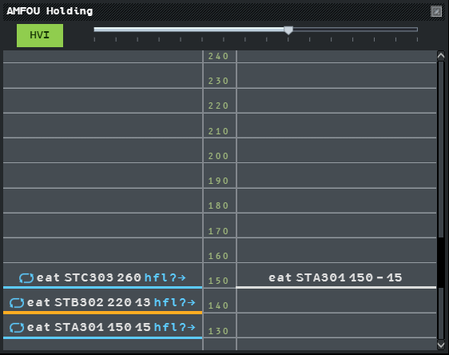
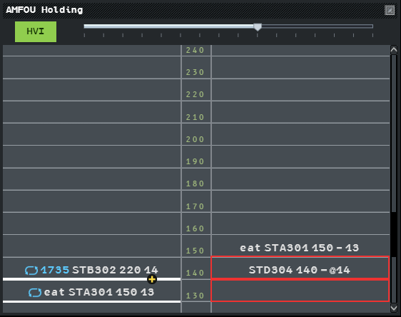
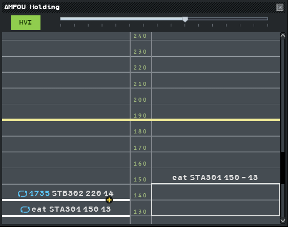

The STAMAN (Stack Manager window) shows the holding of a set of flights on one point. Use it
to plan the holding levels and to see, level by level, who is in the stack.

## Turn it on

The STAMAN exists "by site setting". In g-atm, turn it on in **Tools → External
Applications → Local Settings → STAMAN** (off by default; your choice is kept from one
launch to the next). A position whose standard configuration says `"staman": true` has it
too. See [Local Settings](/5g-atm-doc/reference/local-settings/).

With the STAMAN on:

- the window of a point opens by itself when you enter a hold on that point (see
  [Holding](/5g-atm-doc/traffic/holds/));
- it closes only with its cross;
- **Tools → Stack Manager Windows ▸** lists `<point> Holding` for each point, to reopen a
  closed window.

The Holding List keeps working as before: the STAMAN does not replace it.

## The window

From left to right:

| Part | Shows |
|---|---|
| **Prepa Bay** | The flights that have a hold constraint on the point. Use it to plan their levels |
| Level column | One level every 1,000 ft, from FL660 down to FL010 |
| **Hold Bay** | A vertical cut of the hold: the flights inside the hold volume, with or without a constraint |

The window opens on the levels of the published stack, from 500 ft below to 1,500 ft above;
scroll to see the others. For a point that is not predefined, the view starts at FL100.

:::caution[Not in g-atm]
The **HVI** button and the slider are drawn as the booklet shows them, but the booklet does
not say what they do: they have no action.
:::

## The Prepa Bay

Each flight with a hold on the point has a row, placed on its HFL. A row reads: holding
symbol, EAT (or `eat`), callsign, actual level, CFL, and `hfl?→` while no HFL is set. The
holding symbol and the EAT are blue until acknowledged, as on the label.

### Where a flight without HFL is placed

A flight without HFL sits on a **pseudo HFL**, by order of arrival: the flight that got its
hold clearance first is lowest.

- The first pseudo HFL is the higher of the first level of the published stack and the
  flight's exit level.
- The next flights go 1,000 ft above the highest level already taken.
- Flights beyond the stack are placed above its last published level.
- For a point that is not predefined, the first pseudo HFL is FL100.

When you set an HFL, the other flights without HFL move up above it. A pseudo HFL is not an
HFL: it shows neither on the label nor in the Holding List.

A flight that is neither PREPA nor RESP (see
[States and colours](/5g-atm-doc/flights/states/)) is placed at its selected level (its
actual level on IVAO), and its row is faded.

### The line under a row

The thick line under a row is the flight's HFL line. Its colour compares the CFL with it:

| Colour | Meaning | Example |
|---|---|---|
| Orange | Cleared too low | CFL 110, HFL 130 |
| Blue | Not yet cleared to its HFL | CFL 160, HFL 120 |
| White | Cleared to its HFL | CFL = HFL |

### Gestures

| Gesture | Effect |
|---|---|
| **Left click** `hfl?→` | Validates the pseudo HFL: it becomes the flight's HFL |
| **Drag** the callsign or the line onto another level | The flight takes that level as its HFL |
| **Left click** the EAT | Opens the EAT menu |
| **Left click** the CFL | Opens the CFL menu |

The 3.0 booklet validates `hfl?→` with a plain left click (the 2.1 booklet used a fake
double click).

### Two flights on the same level

If two flights are planned on the same level, the oldest is shown, and a black disc with a
yellow cross sits on the line. **Left click** the symbol to show the next flight, **right
click** it to go back.

## The Hold Bay

The Hold Bay shows the flights that have entered the hold volume of a predefined stack, or
that have overflown a point that is not predefined. It also shows flights **in transit**:
flights without a constraint that cross the volume at the levels the window shows.

Each flight is a box from the lowest to the highest of its actual level, CFL and selected
level: the levels it may occupy now. A flight in level flight is a thick line.

| Box | Meaning |
|---|---|
| White | Normal |
| Orange | The flight has gone more than 200 ft past its CFL |
| Red | The flight is in Overlap alert (HCT) with another box |
| Faded | The flight is neither PREPA nor RESP; its last field is its selected level (`@14`) |

:::caution[IVAO]
The network carries no selected level: on IVAO the boxes use the actual level and the CFL
only.
:::

## Reserve a level

**Middle click a level line** to mark the level unavailable in the stack: the line turns
yellow across both bays. Middle click it again to release it. It is the same reservation as
the middle click in the HFL menu.

## Take a flight out of the STAMAN

A flight leaves the STAMAN when its hold is cancelled:

- the **Cancel** entry of the Hold menu;
- a heading, or a direct beyond the hold point (a heading counts only once the flight is in
  the hold volume);
- the flight physically leaving the volume of a predefined stack.

:::caution[Known limit]
In g-atm 2.0.0 a flight that leaves the hold volume may keep its constraint and stay in the
bays. Cancel its hold by hand.
:::

---

*4-Flight booklet 3.0: §13.2.g (p. 169–174).*
